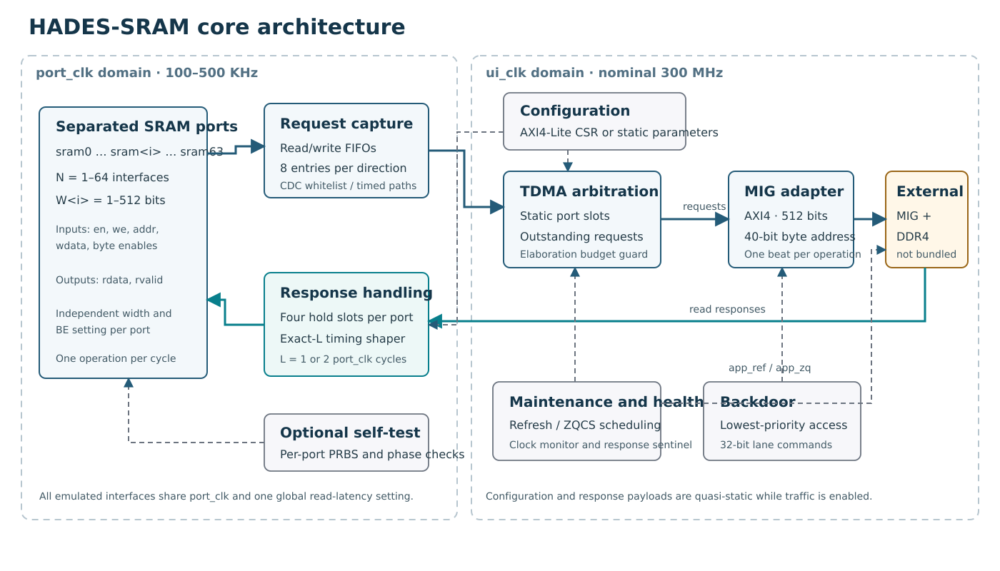
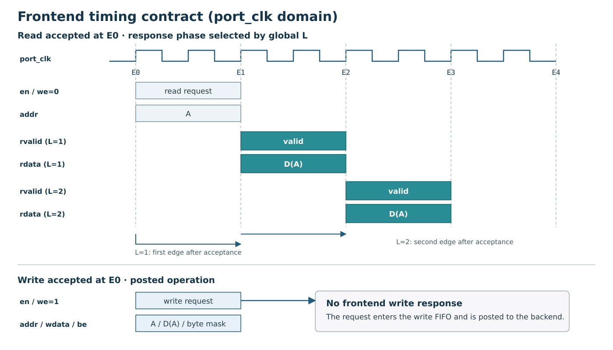
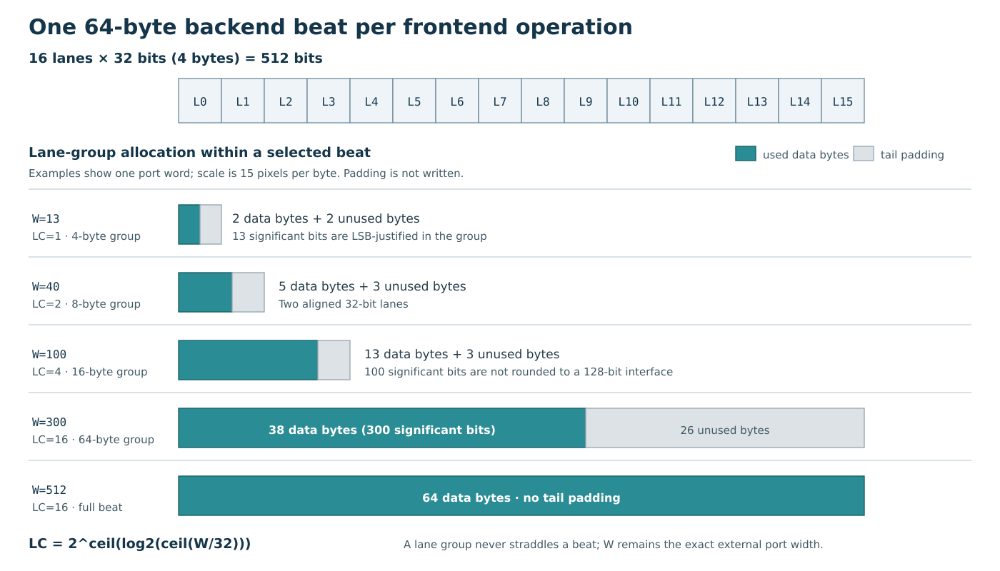
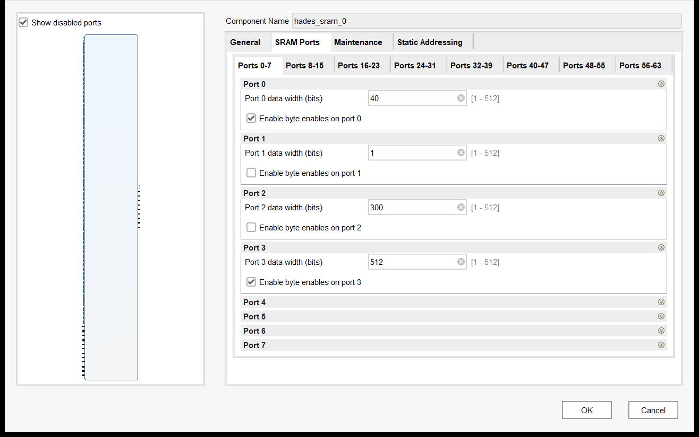
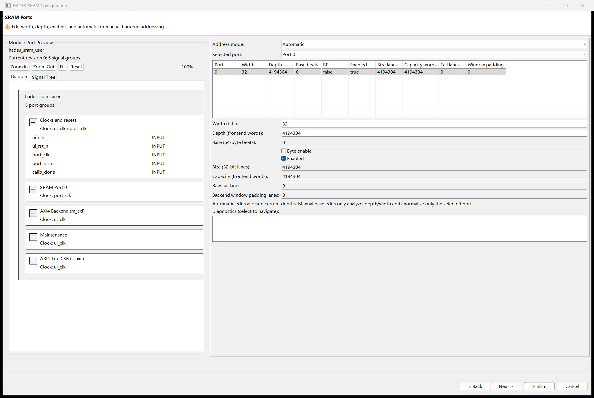
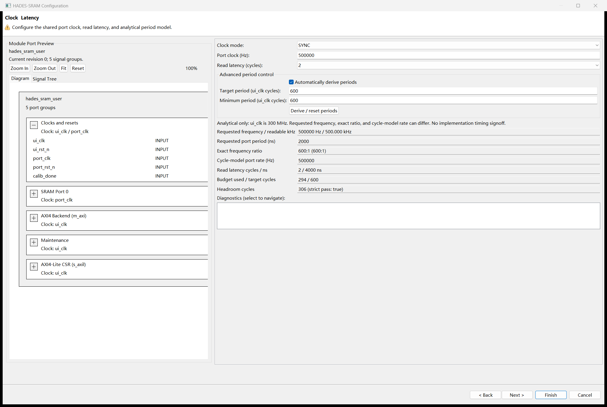
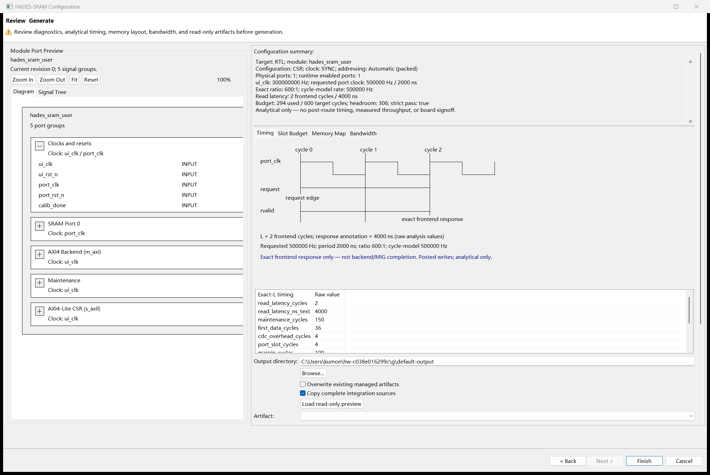
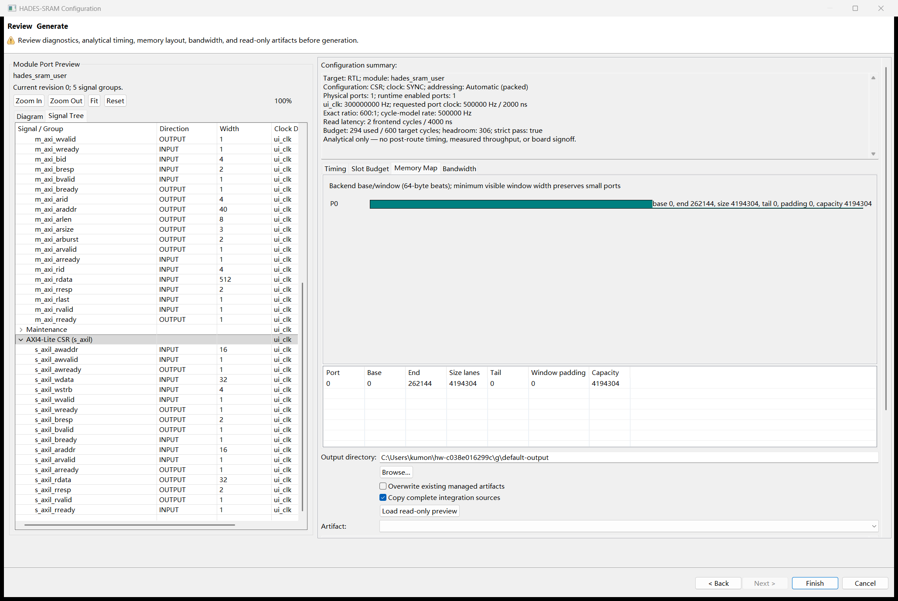

# IP Facts

HADES-SRAM is a synthesizable FPGA IP core that presents multiple independent synchronous-SRAM interfaces backed by one external AMD/Xilinx Memory Interface Generator (MIG) DDR4 channel. It is part of HADES, the Hybrid Accelerated and Distributed Emulation System.

<p class="table-caption">IP Facts: HADES-SRAM core information</p>

| Item | Value |
|---|---|
| Core name | HADES-SRAM |
| Catalog VLNV | `rismd.cn:hades:hades_sram:1.1` |
| Vendor / library | `rismd.cn` / `hades` |
| Catalog taxonomy | `/HADES` |
| Repository release baseline | v1.1.0 |
| Core identification register | `ID = 0xADE50110` |
| Hardware description language | SystemVerilog-2012 |
| Package format | Vivado IP packager / IP-XACT |
| Supported device family | Virtex UltraScale+ Production, as declared by the package |
| Reference device | `xcvu9p-fsgd2104-2L-e` on VCU1525 |
| Verified design-suite version | Vivado 2024.1 |
| Emulated memory interfaces | 1–64 separated `sram<i>` interfaces; default `N=1` |
| Per-interface data width | Independent integer `W<i> = 1…512` bits, including non-powers of two |
| Backend interface | AXI4, 512-bit data, 4-bit ID, 40-bit byte address |
| Configuration interface | Optional AXI4-Lite CSR, 32-bit data, 16-bit byte address |
| Clocking | `ui_clk` nominally 300 MHz; shared `port_clk` from 100 to 500 KHz |
| External memory dependency | A separately integrated MIG and DDR4 channel; not included in the reusable core |
| Reference integration | VCU1525 RTL, constraints, MIG configuration, and JTAG-AXI host scripts |
| Verification | SystemVerilog and DPI-C testbench with VCS and Vivado xsim |
| Product Guide formats | Markdown and PDF; both are included in the generated IP documentation group |

> **Important:** The catalog version is 1.1 and the repository release is v1.1.0. The generated directory name `ip/hades_sram_1.0/` is retained as a packaging path; it is not the catalog version.

# Chapter 1: Overview

HADES-SRAM time-multiplexes one physical DDR4 backend into as many as 64 separated synchronous-SRAM interfaces. The emulated interfaces operate in a slow `port_clk` domain, while the backend, configuration, arbitration, and maintenance logic operate in the much faster `ui_clk` domain. A per-port timing shaper decouples backend response time from the frontend cycle-accurate read-latency contract.

The core is intended for FPGA emulation and prototyping systems that need many independent SRAM instances with deterministic cycle behavior. It is not a general-purpose cache, a multi-channel DDR controller, or a model of asynchronous SRAM analog timing.

## Feature Summary

- One to 64 physical SRAM interfaces, named `sram0` through `sram63`; only interfaces below the elaborated `N` are enabled in the packaged module graph.
- Independent `W0`–`W63` parameters. Every integer width from 1 through 512 is supported, including widths that are not powers of two and widths that are not byte multiples.
- Independent `BE0_EN`–`BE63_EN` byte-enable switches. The byte-enable input is 64 bits on every port, regardless of the selected data width.
- Exact read response latency `L = 1` or `L = 2` `port_clk` cycles, selected globally for all ports. Reads can be accepted on consecutive `port_clk` edges.
- Posted writes with no frontend write-response channel. Each port has separate eight-entry read- and write-request FIFOs.
- One 64-byte AXI backend beat per frontend operation, independent of `W<i>`.
- Synchronous (`IS_SYNC=1`, default) or asynchronous (`IS_SYNC=0`) clock integration. Both modes preserve the same frontend cycle contract.
- AXI4-Lite control/status registers (`CSR_EN=1`) or hard-wired parameter configuration without a boot bus (`CSR_EN=0`).
- Indexed per-port configuration and statistics to avoid a flat per-port CSR address map.
- Scheduled DDR4 refresh and ZQ calibration using the MIG user-refresh and ZQCS handshakes.
- Low-priority 32-bit-lane backdoor access for memory initialization and inspection.
- Optional per-port built-in self-test engines with PRBS data and exact response-phase checking.
- Static elaboration guard for the port-count, clock-mode, and target-period slot budget.
- Vivado IP catalog integration, human-readable customization pages, and separated expandable block-diagram interface tags.



<p class="figure-caption">Figure 1-1: HADES-SRAM functional architecture</p>

The frontend request path captures read and write operations into per-port FIFOs. The backend scheduler opens static service slots and the MIG adapter issues AXI transactions. Read responses enter per-port hold slots. The `port_clk`-domain timing shaper releases each response at the configured cycle, independently of when the DDR4 transaction completed within the allowed budget.

Configuration registers and static parameters produce the same internal configuration representation. Runtime configuration is quasi-static while traffic is enabled; the documented quiesce sequence is required before changing it.

## Applications

HADES-SRAM is suitable for:

- Emulating many independent synchronous SRAMs in a larger FPGA-based emulation system.
- Connecting an emulated design with slow SRAM interfaces to a high-speed DDR4 backing store.
- Prototyping systems that require deterministic read-response cycles rather than statistical memory latency.
- Providing uniform SRAM interfaces whose data widths differ from the physical DDR4 AXI width.
- Using built-in traffic and phase checkers for on-board memory-system verification.

## Supported Configurations and Limitations

The delivered interface supports at most 64 physical ports. The slot-budget test environment exercises larger mathematical configurations to prove the assertion, but those cases do not extend the catalog range or generate additional physical ports.

The following are not provided by this core:

- 7-series FPGA or DDR3 backend variants.
- C1–C3 or other additional MIG channels; only one AXI4 memory backend is used.
- Independent clocks or independent read-latency settings per SRAM port.
- Data widths greater than the 512-bit single-beat backend width.
- Caching, prefetching, write coalescing, or multi-channel striping.
- Asynchronous-SRAM subcycle timing models such as nanosecond `tAA` or `tRC`.
- A DMA content-loading engine, PCIe/XDMA host driver, or a MIG instance inside the reusable IP.
- ECC correction in the reference MIG configuration.
- A CSR readout for self-test counters in the static configuration.
- Self-test pattern generation for physical widths other than 32 or 64 bits. The datapath supports 1–512 bits when self-test is not included; the code generator rejects unsupported self-test combinations.

All ports share `port_clk` and the global latency setting. Physical port count, data widths, byte-enable switches, address width, and clock mode are elaboration-time choices. Runtime CSR writes cannot create ports or alter those physical properties.

On the VCU1525 reference platform, full read+write traffic is practical up to 56 ports at the default 32-bit width; read-only traffic reaches 64. Partial-beat write handling in the fitted MIG/RDIMM configuration is the limiting factor. Other configurations require system-level throughput and timing verification.

## Licensing and Ordering

HADES-SRAM contains no runtime activation, license-key, or ordering-code mechanism. The source repository does not include a `LICENSE` file; this guide does not grant or infer redistribution rights. Obtain source-use and distribution terms from the repository distributor.

AMD Vivado, MIG, and other AMD materials are subject to their own terms. VCS and any other third-party tools are likewise separate from the HADES-SRAM source. No AMD/Xilinx LogiCORE license or endorsement is implied.

# Chapter 2: Product Specification

## Standards and Interface Scope

The maintained RTL is SystemVerilog-2012. The generated package uses Vivado IP-XACT data and custom SRAM bus/abstraction definitions. The AXI interfaces use Arm AMBA signal and handshake conventions.

The `m_axi` master implements the subset required by the MIG connection: single-beat, 64-byte INCR reads and writes, 512-bit data, 4-bit IDs, and 40-bit byte addresses. `AWLEN` and `ARLEN` are zero, `AWSIZE` and `ARSIZE` are `0b110` (64 bytes), and `AWBURST` and `ARBURST` are `0b01` (INCR). Every write has one data beat with `WLAST` asserted.

The optional `s_axil` slave is a 32-bit AXI4-Lite register interface in the `ui_clk` domain. It supports independent write-address/write-data capture, byte strobes on writable register fields, and single-beat reads. Responses are `OKAY`; unimplemented offsets read as zero and invalid writes do not generate a bus error.

These statements describe the implemented interface subset, not an independent formal protocol-certification claim. Appendix B lists the exercised compliance and interoperability coverage.

## Performance

### Frontend Timing and Throughput

<p class="table-caption">Table 2-1: Frontend performance parameters</p>

| Parameter | Value or rule |
|---|---|
| Backend clock | `ui_clk`, nominal 300 MHz |
| Emulated-port clock | One shared `port_clk`, 100–500 KHz |
| Frequency ratio at 500 KHz | 600 `ui_clk` cycles per `port_clk` cycle at nominal frequencies |
| Frequency ratio at 100 KHz | 3000 `ui_clk` cycles per `port_clk` cycle at nominal frequencies |
| Request rate | Up to one read or write per enabled port per `port_clk` cycle |
| Read latency | Exactly 1 or 2 `port_clk` cycles after request acceptance |
| Write behavior | Accepted into an eight-entry write FIFO and posted to the backend |
| Backend transfer size | One 512-bit (64-byte) beat per frontend operation |
| Effect of port width on latency | None; `W<i>` and `BE<i>_EN` do not change the exact-L contract |

The latency is counted in frontend cycles, not in nanoseconds and not in MIG response cycles. Data can arrive early in a hold slot; the timing shaper releases it only at the configured response edge. A backend fault that prevents timely service sets an error indication; it must not be interpreted as a successful memory access.

The aggregate frontend payload rate is the sum of active `W<i> × port_clk` bits per operation. The backend allocates a full 64-byte beat for each operation, so backend bandwidth is not proportional to useful payload for narrow ports. DDR efficiency, refresh, arbitration, and read-modify-write behavior must be included in system throughput analysis.

### Static Slot Budget

The core checks the following bound during elaboration:

```text
MAINT_SLOTS + FIRST_LAT + CDC_OVHD + N*SLOT_PER_PORT + MARGIN
  < TARGET_PERIOD_CYCLES
```

<p class="table-caption">Table 2-2: Slot-budget constants</p>

| Constant | Value | Meaning |
|---|---:|---|
| `MAINT_SLOTS` | 150 | Maintenance-window allocation in `ui_clk` cycles |
| `FIRST_LAT` | 36 | Backend first-data latency allocation |
| `SLOT_PER_PORT` | 4 | Backend service allocation per port |
| `CDC_OVHD` | 4 SYNC / 12 ASYNC | Clock-crossing allocation |
| `MARGIN` | 100 | Required residual headroom |
| `TARGET_PERIOD_CYCLES` | 600 default | Target period in `ui_clk` cycles; 3000 is the 100 KHz setting |

<p class="table-caption">Table 2-3: Example slot-budget evaluations</p>

| N | Clock mode | Target period | Left side of bound | Result |
|---:|---|---:|---:|---|
| 32 | SYNC | 600 | 418 | Pass |
| 56 | SYNC | 600 | 514 | Pass |
| 64 | SYNC | 600 | 546 | Pass |
| 64 | ASYNC | 600 | 554 | Pass |
| 128 | SYNC | 600 | 806 | Rejected by the budget assertion |
| 128 | SYNC | 3000 | 806 | Budget passes; outside the supported physical-port range |

The assertion uses elaborated `N`; reducing `CFG_PORTS` or a runtime enable mask does not relax it. A failing configuration must be corrected by reducing `N`, increasing `TARGET_PERIOD_CYCLES`, or selecting an appropriate clock mode. The physical interface remains limited to 64 ports even when a larger mathematical configuration fits the budget.

The nominal slot for port `i` is:

```text
slot_of(i) = MAINT_SLOTS + FIRST_LAT + CDC_OVHD + i*SLOT_PER_PORT
```

Eligibility latches until the backend grants the request. This allows in-order service to absorb a stall without dropping a request; the response-window sentinel is the runtime backstop if the budget is violated.

## Resource Utilization

Table 2-4 reports actual out-of-context synthesis results from the packaged IP checkpoints. The device is `xcvu9p-fsgd2104-2L-e`, the speed file is `-2L`, and the tool is Vivado 2024.1. These are synthesized-core values, not full-board values and not post-route maxima.

<p class="table-caption">Table 2-4: Packaged-core OOC synthesis utilization</p>

| Configuration | CLB LUTs | LUT as memory | CLB registers | CARRY8 | Block RAM tiles | URAM | DSPs |
|---|---:|---:|---:|---:|---:|---:|---:|
| Default: `N=1`, `W0=32`, BE off, CSR on, self-test off | 5,960 | 48 | 7,773 | 147 | 0 | 0 | 0 |
| Mixed: `N=4`, `W=40/1/300/512`, BE on ports 0 and 3, CSR on, self-test off | 13,292 | 648 | 16,520 | 183 | 0 | 0 | 0 |

Synthesis reports caution that physical optimization and full implementation can reduce the final LUT count. Port count, width, static/CSR selection, self-test logic, constraints, and integration hierarchy all affect utilization. Run `report_utilization` on the exact generated configuration for capacity planning.

The VCU1525 reference design instantiates `N=64`, all widths 32, CSR enabled, and self-test enabled. Its final SYNC implementation has the timing results in Table 2-5. These results include the reference integration and are not standalone-core Fmax guarantees.

<p class="table-caption">Table 2-5: VCU1525 reference implementation timing</p>

| Build | Nominal backend target | Setup WNS | Hold WNS | Timing result |
|---|---:|---:|---:|---|
| SYNC, N=64, all W=32, self-test enabled | 300 MHz | +0.001 ns | +0.010 ns | All user timing constraints met |

## Port Descriptions

All directions are relative to `hades_sram_top`. A symbolic row `sram<i>` describes the corresponding signal on every implemented interface `0 ≤ i < N`; these are separate physical signals, not packed SystemVerilog arrays.

### Clocks, Resets, and Calibration

<p class="table-caption">Table 2-6: Clock, reset, and calibration ports</p>

| Signal | Direction | Width | Description |
|---|---|---:|---|
| `ui_clk` | Input | 1 | Backend, CSR, arbitration, maintenance, and MIG-adapter clock; nominal 300 MHz |
| `ui_rst_n` | Input | 1 | Active-low external reset for the `ui_clk` domain; asynchronous assertion, synchronous internal release |
| `port_clk` | Input | 1 | Shared SRAM-interface clock, 100–500 KHz |
| `port_rst_n` | Input | 1 | Active-low external reset for the `port_clk` domain; asynchronous assertion, synchronous internal release |
| `calib_done` | Input | 1 | Connect MIG `init_calib_complete`; registered at the core boundary before use |

Hold the datapath in reset until the clocking and MIG calibration strategy is stable. `port_rst_n` must be driven by a reset source suitable for the selected SYNC or ASYNC integration; it is not internally derived from `ui_rst_n` for arbitrary integrations.

### Emulated SRAM Interfaces

<p class="table-caption">Table 2-7: Signals on each sram&lt;i&gt; interface</p>

| Signal | Direction | Width | Description |
|---|---|---:|---|
| `sram<i>_en` | Input | 1 | Request enable. A request is accepted when high with global enable and the port's runtime enable active |
| `sram<i>_we` | Input | 1 | 1 = write, 0 = read |
| `sram<i>_addr` | Input | `AW` | Frontend word address in units of `W<i>` bits, not a byte or backend-lane address |
| `sram<i>_wdata` | Input | `W<i>` | Write data, exactly the configured port width |
| `sram<i>_be` | Input | 64 | Byte mask; only bits `[ceil(W<i>/8)-1:0]` are used when `BE<i>_EN=1` |
| `sram<i>_rdata` | Output | `W<i>` | Read data, exactly the configured port width |
| `sram<i>_rvalid` | Output | 1 | Read-response valid exactly `L` `port_clk` edges after accepted request |

There is no per-port ready or backpressure output. Do not present requests while the core or selected port is disabled, in reset, or otherwise outside the integration's configured active set. Configure `CFG_PORTS` and `PORT_EN_LO/HI` consistently; both the active-count and enable-mask conditions participate in backend scheduling.

### AXI4 Memory Backend

<p class="table-caption">Table 2-8: m_axi write-address, write-data, and write-response ports</p>

| Signal | Direction | Width | Description |
|---|---|---:|---|
| `m_axi_awid` | Output | 4 | Write transaction ID |
| `m_axi_awaddr` | Output | 40 | 64-byte-aligned byte address |
| `m_axi_awlen` | Output | 8 | Zero: one beat per write |
| `m_axi_awsize` | Output | 3 | `0b110`: 64 bytes per beat |
| `m_axi_awburst` | Output | 2 | `0b01`: INCR |
| `m_axi_awvalid` / `m_axi_awready` | Output / Input | 1 | Write-address handshake |
| `m_axi_wdata` | Output | 512 | Write-data beat; port data is LSB-justified in its lane group |
| `m_axi_wstrb` | Output | 64 | Byte strobes, including used-byte and optional per-port byte-enable masks |
| `m_axi_wlast` | Output | 1 | Asserted on the single write-data beat |
| `m_axi_wvalid` / `m_axi_wready` | Output / Input | 1 | Write-data handshake |
| `m_axi_bid` | Input | 4 | Write-response ID |
| `m_axi_bresp` | Input | 2 | Write-response status |
| `m_axi_bvalid` / `m_axi_bready` | Input / Output | 1 | Write-response handshake |

<p class="table-caption">Table 2-9: m_axi read-address and read-data ports</p>

| Signal | Direction | Width | Description |
|---|---|---:|---|
| `m_axi_arid` | Output | 4 | Read transaction ID |
| `m_axi_araddr` | Output | 40 | 64-byte-aligned byte address |
| `m_axi_arlen` | Output | 8 | Zero: one beat per read |
| `m_axi_arsize` | Output | 3 | `0b110`: 64 bytes per beat |
| `m_axi_arburst` | Output | 2 | `0b01`: INCR |
| `m_axi_arvalid` / `m_axi_arready` | Output / Input | 1 | Read-address handshake |
| `m_axi_rid` | Input | 4 | Read-response ID |
| `m_axi_rdata` | Input | 512 | Read-data beat |
| `m_axi_rresp` | Input | 2 | Read-response status |
| `m_axi_rlast` | Input | 1 | Last-beat indication; every read is one beat |
| `m_axi_rvalid` / `m_axi_rready` | Input / Output | 1 | Read-data handshake |

The AXI backend and CSR clock association is `ui_clk`. Optional AXI sideband signals not listed in these tables are not generated by the core.

### MIG Maintenance and AXI4-Lite CSR

<p class="table-caption">Table 2-10: MIG maintenance ports</p>

| Signal | Direction | Width | Description |
|---|---|---:|---|
| `app_ref_req` | Output | 1 | User refresh request to MIG |
| `app_ref_ack` | Input | 1 | MIG refresh acknowledgment |
| `app_zq_req` | Output | 1 | User ZQCS request to MIG |
| `app_zq_ack` | Input | 1 | MIG ZQCS acknowledgment |

The MIG must enable **User Refresh and ZQCS Input**. The core expects the corresponding acknowledgment handshakes and schedules these operations in maintenance windows.

<p class="table-caption">Table 2-11: s_axil AXI4-Lite ports, CSR_EN=1</p>

| Signal | Direction | Width | Description |
|---|---|---:|---|
| `s_axil_awaddr` | Input | 16 | Register byte-write address |
| `s_axil_awvalid` / `s_axil_awready` | Input / Output | 1 | Write-address handshake |
| `s_axil_wdata` | Input | 32 | Register write data |
| `s_axil_wstrb` | Input | 4 | Register byte strobes |
| `s_axil_wvalid` / `s_axil_wready` | Input / Output | 1 | Write-data handshake |
| `s_axil_bresp` | Output | 2 | Write response, always `OKAY` |
| `s_axil_bvalid` / `s_axil_bready` | Output / Input | 1 | Write-response handshake |
| `s_axil_araddr` | Input | 16 | Register byte-read address |
| `s_axil_arvalid` / `s_axil_arready` | Input / Output | 1 | Read-address handshake |
| `s_axil_rdata` | Output | 32 | Register read data |
| `s_axil_rresp` | Output | 2 | Read response, always `OKAY` |
| `s_axil_rvalid` / `s_axil_rready` | Output / Input | 1 | Read-data handshake |

With `CSR_EN=0`, the CSR block is not instantiated and no CSR boot bus or initialization sequence is required. Tie the unused AXI4-Lite inputs to inactive values and use the static parameters and pin-level status/backdoor interface instead.

### Static Status and Pin-Level Backdoor

<p class="table-caption">Table 2-12: Static status outputs</p>

| Signal | Direction | Width | CSR_EN=0 behavior | CSR_EN=1 behavior |
|---|---|---:|---|---|
| `stat_calib_done` | Output | 1 | Calibration status | Tied to 0; read `STATUS` instead |
| `stat_ready` | Output | 1 | Effective auto-enable status | Tied to 0; read `STATUS` instead |
| `stat_refresh_active` | Output | 1 | Refresh active | Refresh active |
| `stat_zq_active` | Output | 1 | ZQCS active | ZQCS active |
| `stat_err` | Output | 8 | Bits 5:0 are the static error/clock-health mirror; bits 7:6 are zero | Tied to 0; read `ERR_STATUS` instead |

The static error mirror uses levels: bit 4 indicates an unhealthy/stopped or over-frequency port clock, while bits 0–3 and 5 retain their corresponding error states. It is not a replacement for the CSR indexed error records.

<p class="table-caption">Table 2-13: Pin-level backdoor ports, CSR_EN=0</p>

| Signal | Direction | Width | Description |
|---|---|---:|---|
| `bkp_req` | Input | 1 | Request; synchronized into `ui_clk`. Hold asserted with stable fields until acknowledgment |
| `bkp_we` | Input | 1 | 1 = write one 32-bit lane, 0 = read one 32-bit lane |
| `bkp_port` | Input | 8 | Target port index; use an implemented port below `N` |
| `bkp_addr` | Input | 34 | 32-bit-lane offset within the selected port, zero-extended internally to 40 bits |
| `bkp_wdata` | Input | 32 | Lane write data |
| `bkp_rdata` | Output | 32 | Lane read result, valid with `bkp_ack` |
| `bkp_ack` | Output | 1 | One-`ui_clk`-cycle completion pulse; also used for posted-write completion |

With `CSR_EN=1`, the pin backdoor inputs are unused and the `BKP_*` registers provide a 40-bit lane offset. Backdoor commands use 32-bit lane units in both variants.

## Register Space

The AXI4-Lite register window is 64 KiB in the package memory map. Offsets in this section are byte offsets relative to the core CSR base. On the VCU1525 reference design the core CSR base is `0x0000_0000`; board-control registers are separate at `0x0001_0000`.

Unimplemented bits and unlisted offsets read as zero. Writes to read-only or undefined locations are ignored without an AXI error. Reset defaults are safe: `ENABLE=0`, `CFG_PORTS=0`, and all runtime port-enable bits are zero.

`RO` means read-only, `RW` means read/write, `WO` means write-only, and `W1C` means writing one clears the indicated status bit. Unless otherwise stated, reserved fields read as zero and must be written as zero.

### Global Register Summary

<p class="table-caption">Table 2-14: Global CSR registers</p>

| Offset | Name | Access | Reset / read value | Purpose |
|---|---|---|---|---|
| `0x00` | `CTRL` | RW / strobe | `0x00000000` | Enable, soft reset, optional self-test |
| `0x04` | `STATUS` | RO | Dynamic | Calibration, ready, refresh, and ZQ status |
| `0x08` | `CFG_LATENCY` | RW | `0x00000002` | Global read latency, 1 or 2 |
| `0x0C` | `CFG_PORTS` | RW | `0x00000000` | Runtime active-port count |
| `0x10` | `MEAS_PERIOD` | RO | Dynamic | Measured `port_clk` period in `ui_clk` cycles |
| `0x14` | `PORT_EN_LO` | RW | `0x00000000` | Runtime enable mask for ports 31:0 |
| `0x18` | `PORT_EN_HI` | RW | `0x00000000` | Runtime enable mask for ports 63:32 |
| `0x1C` | `CFG_MIN_PERIOD` | RW | `0x00000258` (600) | Minimum legal measured period |
| `0x40` | `CFG_REFRESH_DIV` | RW | `0x00000834` (2100) | Refresh interval in `ui_clk` cycles |
| `0x44` | `CFG_ZQ_DIV` | RW | `0x00007D00` (32000) | ZQCS interval in requested `port_clk` periods |
| `0x50` | `ERR_STATUS` | RW / W1C | `0x00000000` | Global errors and first-error port field |
| `0x54` | `ERR_ADDR` | RO | `0x00000000` | First-error address, where available |
| `0x58` | `STAT_MAXLAT` | RO | `0x00000000` | Maximum observed backend read latency in `ui_clk` cycles |
| `0x5C` | `STAT_REFCNT` | RO | `0x00000000` | Cumulative refresh count |
| `0x60` | `STAT_TOT_RD_LO` | RO | `0x00000000` | Global read count bits 31:0 |
| `0x64` | `STAT_TOT_WR_LO` | RO | `0x00000000` | Global write count bits 31:0 |
| `0x68` | `STAT_TOT_RD_HI` | RO | `0x00000000` | Global read count bits 63:32 |
| `0x6C` | `STAT_TOT_WR_HI` | RO | `0x00000000` | Global write count bits 63:32 |
| `0x80` | `ID` | RO | `0xADE50110` | HADES magic and core version 1.1.0 |
| `0x84` | `PARAMS` | RO | Configuration-dependent | Clock mode, nominal backend MHz, default capacity/lane size, and `N_MAX` |

### Global Register Fields

<p class="table-caption">Table 2-15: Control, status, and configuration fields</p>

| Register | Bits | Access | Description |
|---|---|---|---|
| `CTRL` | 0 `ENABLE` | RW | Request global enable. A write of 1 is rejected unless calibration is complete and the clock is healthy |
| `CTRL` | 1 `SOFT_RESET` | WO strobe | Self-clearing. Clears enable, self-test request, errors, and statistics while retaining configuration; reads as 0 |
| `CTRL` | 2 `SELFTEST` | RW | Self-test run level when `SELFTEST_EN=1`; otherwise reads as 0 and has no effect |
| `STATUS` | 0 `CALIB_DONE` | RO | MIG calibration complete |
| `STATUS` | 1 `READY` | RO | Effective enable after interlocks and reset stretching |
| `STATUS` | 2 `REFRESH_ACTIVE` | RO | Refresh operation active |
| `STATUS` | 3 `ZQ_ACTIVE` | RO | ZQCS operation active |
| `CFG_LATENCY` | 1:0 | RW | Legal values are 1 and 2. Other values are ignored; bits 8:15 are reserved for future grouping |
| `CFG_PORTS` | 7:0 | RW | Active-port count. Set no greater than elaborated `N` and keep the enable mask consistent |
| `MEAS_PERIOD` | 31:0 | RO | Continuously measured port period in `ui_clk` cycles |
| `PORT_EN_LO/HI` | 31:0 | RW | Runtime enable bitmap. Physical ports above `N-1` must remain disabled |
| `CFG_MIN_PERIOD` | 31:0 | RW | If measured period is shorter, enable is rejected or effective enable is withdrawn |
| `CFG_REFRESH_DIV` | 31:0 | RW | 2100 cycles is 7 microseconds at nominal 300 MHz |
| `CFG_ZQ_DIV` | 31:0 | RW | An interval of 32000 requested `port_clk` periods is approximately 64 ms at 500 KHz |

`CFG_LATENCY` is a shadow setting. It takes effect on the next `ENABLE` 0-to-1 transition; changing it while enabled does not change the active latency.

`CTRL.ENABLE` records the requested enable, while `STATUS.READY` reports the effective enable. Loss or over-frequency of `port_clk` withdraws effective enable and sets `ERR_STATUS.bit4`; effective enable recovers automatically when the clock is healthy, without another enable write.

`SOFT_RESET` stretches port-domain reset and gates ready until the reset has propagated and released. Poll `STATUS.READY` after re-enabling rather than assuming a fixed CSR-only delay.

<p class="table-caption">Table 2-16: Error and identification fields</p>

| Register | Bits | Access | Description |
|---|---|---|---|
| `ERR_STATUS` | 0 | W1C | Illegal frontend address |
| `ERR_STATUS` | 1 | W1C | Backend response timeout; a read unanswered for 768 `ui_clk` cycles completes with synthetic zeros |
| `ERR_STATUS` | 2 | W1C | Dropped-request/request-overflow sentinel; must remain zero in legal operation |
| `ERR_STATUS` | 3 | W1C | AXI `SLVERR` observed |
| `ERR_STATUS` | 4 | W1C | Enable rejected, calibration/clock health withdrawn, or port clock stopped/over-frequency |
| `ERR_STATUS` | 5 | W1C | Response-window violation; must remain zero in a legal configuration |
| `ERR_STATUS` | 13:8 | RO | First recorded datapath-error port index |
| `ERR_ADDR` | 31:0 | RO | Address associated with the first recorded error where available; zero for events without an address |
| `ID` | 31:16 | RO | `0xADE5` HADES identification |
| `ID` | 15:12, 11:8, 7:0 | RO | Major=1, minor=1, patch=0 |
| `PARAMS` | 31 | RO | Clock mode: 0=ASYNC, 1=SYNC |
| `PARAMS` | 30:20 | RO | Nominal `ui_clk` frequency in MHz; 300 in the current core |
| `PARAMS` | 19:12 | RO | Default port capacity in MiB; 16 |
| `PARAMS` | 11:8 | RO | Default 32-bit-lane size in bytes; 4 |
| `PARAMS` | 7:0 | RO | Maximum physical port count, `N_MAX=64` |

Hardware error events win over a simultaneous W1C clear. Clearing all global error bits also clears the first-error port/address information. A persistent unhealthy-clock condition can set bit 4 again after it is cleared. Treat timeout and response-window violations as fatal backend/integration alarms.

Global read/write statistics are 64-bit counters accessed as low/high 32-bit registers. Backdoor traffic increments global statistics but not per-port statistics.

### Indexed Port Window

Write `PORT_SEL`, then access the selected port's registers. This avoids dedicating a separate CSR page to each port. Select only physically implemented ports below `N`; selector values from 64 through 255 return zero for indexed reads and ignore indexed writes.

<p class="table-caption">Table 2-17: Indexed port registers</p>

| Offset | Name | Access | Reset / read value | Description |
|---|---|---|---|---|
| `0x20` | `PORT_SEL` | RW | 0 | Port index selector, bits 7:0 |
| `0x24` | `PORT_BASE` | RW | Low 32 bits of `port*2^18` | Selected port base in 64-byte beats, bits 31:0 |
| `0x28` | `PORT_BASE_HI` | RW | 0 | Selected port base bits 33:32; write only bits 1:0 |
| `0x2C` | `PORT_SIZE` | RW | `2^22` | Selected port size in **32-bit lane words** |
| `0x30` | `PORT_STAT_RD` | RO | 0 | Selected port read count |
| `0x34` | `PORT_STAT_WR` | RO | 0 | Selected port write count |
| `0x38` | `PORT_STAT_ERR` | RO / clear on write | 0 | Selected port error count, including self-test errors when built; any write clears it |
| `0x3C` | `PORT_WIDTH` | RO | `W<port>` | Selected port's elaboration width in bits, bits 9:0 |

`PORT_SIZE` is not a count of `W<i>`-bit frontend words. The frontend capacity is `floor(PORT_SIZE/LC)`, where `LC` is defined in Chapter 3. `PORT_BASE` and `PORT_BASE_HI` together form a 34-bit beat address, which is shifted left by six to form the AXI byte address.

The default base for port `i` is `i × 2^18` beats, giving 16 MiB of address spacing. The default size is `2^22` 32-bit lanes, also a 16 MiB backend-lane span. Width changes do not automatically resize these windows.

### Backdoor Registers

The backdoor is the lowest-priority memory requester, served when no frontend port is eligible. It can run while global enable is deasserted and is intended for initialization and sparse inspection. Wait for MIG calibration before depending on backend completion.

<p class="table-caption">Table 2-18: Backdoor CSR registers</p>

| Offset | Name | Access | Reset | Description |
|---|---|---|---|---|
| `0x90` | `BKP_PORT` | RW | 0 | Target port index, bits 7:0 |
| `0x94` | `BKP_ADDR` | RW | 0 | Target **32-bit-lane offset**, bits 31:0 |
| `0x98` | `BKP_ADDR_HI` | RW | 0 | Target lane offset bits 39:32 |
| `0x9C` | `BKP_WDATA` | RW | 0 | 32-bit-lane write data |
| `0xA0` | `BKP_CMD` | WO | Reads as 0 | Bit 0 triggers write; bit 1 triggers read; self-clearing |
| `0xA4` | `BKP_RDATA` | RO | 0 | 32-bit-lane read result, valid when done |
| `0xA8` | `BKP_STATUS` | RO | 0 | Bit 0 busy, bit 1 done, bit 2 command error |

A new command clears the sticky done indication. Poll `BKP_STATUS.busy` before issuing another command; commands while busy are ignored. `BKP_STATUS.done` is set on completion, and `BKP_STATUS.error` remains set until the next command when a command is illegal or has an address at or above `PORT_SIZE`.

Use only implemented target ports. The command datapath checks the physical ceiling `N_MAX=64`; software is responsible for the tighter elaborated-`N` integration boundary.

### Self-Test Register Behavior

With `SELFTEST_EN=1`, each implemented port has a `port_clk`-domain checker. The current pattern generator supports 32- or 64-bit physical ports only; other widths must not include self-test. Setting `CTRL.SELFTEST` starts all enabled ports. Each writes and reads `SELFTEST_BLK` words using a per-port PRBS pattern and checks data and exact response phase. Errors increment the corresponding `PORT_STAT_ERR`; they do not set global `ERR_STATUS`.

Stop self-test and wait at least 16 `port_clk` periods before clearing enable or issuing `SOFT_RESET`. While self-test is active it drives the request inputs instead of the external pins. In the static variant, enabled self-test engines run automatically and their per-port counters have no bus readout.

# Chapter 3: Designing with the Core

## General Design Guidelines

1. Select the physical configuration first: `N`, per-port `W<i>`, per-port `BE<i>_EN`, `AW`, and `IS_SYNC`.
2. Check the elaboration slot bound against `TARGET_PERIOD_CYCLES`. Do not rely on runtime masks to make an illegal physical configuration pass.
3. Connect a 512-bit MIG AXI4 interface and the refresh/ZQCS handshakes. Connect `init_calib_complete` to `calib_done`.
4. Declare both clocks and their actual relationship. Use SYNC only when the same-source, static-phase requirement is met.
5. Hold the datapath in reset during clock and memory initialization. Release each reset only when its associated clock is running.
6. Choose CSR or static configuration and establish nonoverlapping per-port address windows. Keep the configured sizes within the `AW`-addressable frontend range and the 40-bit AXI byte-address range.
7. Initialize memory contents before reading them when contents matter. Resetting the core does not clear or initialize DDR4.
8. Enable traffic only after calibration and clock-health checks pass. Monitor global and per-port errors during operation.
9. Quiesce traffic before changing quasi-static configuration, stopping a clock, or reprogramming the device.
10. Review utilization, timing, and CDC results for the exact generated configuration and integration hierarchy.

## SRAM Read and Write Operations

A request is accepted on a rising `port_clk` edge when `sram<i>_en=1`, global effective enable is active, and the corresponding runtime port-enable bit is set. The port must also belong to the configured active set so that its request receives a backend service slot.

For a read, drive `sram<i>_we=0` and a legal frontend word address. The response appears exactly `L` rising `port_clk` edges after acceptance. `sram<i>_rvalid` marks each response cycle, and `sram<i>_rdata` carries exactly `W<i>` bits. Consecutive read requests are supported; `rvalid` can consequently be active on consecutive cycles.

For a write, drive `sram<i>_we=1`, a legal address, write data, and byte enables when enabled. Acceptance places the request in the write FIFO. There is no frontend write-response strobe. Backend errors must be observed through CSR or static status, not inferred from frontend pins.



<p class="figure-caption">Figure 3-1: Exact-L read timing and posted-write timing</p>

`E0` is the request-acceptance edge. For `L=1`, the response is at `E1`; for `L=2`, it is at `E2`. The backend can complete earlier, but it cannot change this response phase.

Adjacent write-then-read sequences, including consecutive-cycle access to the same address, are supported by the verified per-port ordering model. A single port cannot issue a read and a write in the same cycle because `we` selects one operation per accepted request.

The eight-entry request FIFOs and four response hold slots per port are internal scheduling resources, not user-visible queues. The static slot budget and response-window sentinel are the protection against overflow or late responses; they are not a license to ignore error status.

## Address and Lane Model

### Lane Groups

Each backend beat contains sixteen 32-bit lanes, or 64 bytes. A port of width `W` occupies a power-of-two number of consecutive lanes:

```text
LC = 2^ceil(log2(ceil(W/32)))
s  = log2(LC)
```

`LC` is therefore 1, 2, 4, 8, or 16. The group is naturally aligned within a beat and never straddles a beat boundary. The external interface remains exactly `W` bits even when `LC×32` is larger than `W`.

<p class="table-caption">Table 3-1: Width-to-lane-group mapping</p>

| Width W (bits) | LC | Group size | Used data bytes |
|---|---:|---:|---:|
| 1–32 | 1 | 4 bytes | `ceil(W/8)`, from 1 through 4 |
| 33–64 | 2 | 8 bytes | 5 through 8 |
| 65–128 | 4 | 16 bytes | 9 through 16 |
| 129–256 | 8 | 32 bytes | 17 through 32 |
| 257–512 | 16 | 64 bytes | 33 through 64 |

The data word is LSB-justified within its group. Only `ceil(W/8)` bytes are significant to the frontend write mask; unused tail lanes and tail bytes are not written. If `W` is not a byte multiple, the high unused bits of the last used byte are not part of the frontend word.



<p class="figure-caption">Figure 3-2: Backend lanes and non-power-of-two width examples</p>

### Frontend Address Translation

For a frontend word address `addr`, the backend beat address and the first lane of its group within that beat are:

```text
words_per_beat = 16 / LC
beat           = PORT_BASE + floor(addr / words_per_beat)
lane_group     = (addr mod words_per_beat) * LC
m_axi_byte_addr = beat * 64
```

`PORT_BASE` is in 64-byte-beat units. `PORT_SIZE` is in 32-bit-lane units. A legal frontend address satisfies both the representable `AW`-bit range and:

```text
0 <= addr < floor(PORT_SIZE / LC)
```

An illegal frontend address produces an error record rather than a backend AXI access. Do not use the associated read data as a valid memory result.

For a CSR write, the 34-bit `PORT_BASE` is assembled from `PORT_BASE_HI[1:0]` and `PORT_BASE[31:0]`. For static configuration, port `i` uses `P_PORT_BASE[i*34 +: 34]` and `P_PORT_SIZE[i*32 +: 32]`.

### Default Capacity Examples

The default base for port `i` is `i × 2^18` beats and the default size is `2^22` lane words for every port. The base spacing and size are independent of `W<i>`; changing a width does not resize or relocate the address map.

<p class="table-caption">Table 3-2: Default-window capacity by port width</p>

| W | LC | Used bytes / group | Group bytes | Frontend words per beat | Default frontend words (`PORT_SIZE=2^22`) |
|---:|---:|---:|---:|---:|---:|
| 13 | 1 | 2 | 4 | 16 | `2^22` = 4,194,304 |
| 32 | 1 | 4 | 4 | 16 | `2^22` = 4,194,304 |
| 40 | 2 | 5 | 8 | 8 | `2^21` = 2,097,152 |
| 100 | 4 | 13 | 16 | 4 | `2^20` = 1,048,576 |
| 300 | 16 | 38 | 64 | 1 | `2^18` = 262,144 |
| 512 | 16 | 64 | 64 | 1 | `2^18` = 262,144 |

At `W=32`, the default capacity is `2^22` words × 4 bytes = 16 MiB. At `W=40`, it is `2^21` words × 5 used bytes = 10 MiB, although each word occupies an eight-byte lane group. At `W=300`, it is `2^18` words × 38 used bytes = 9.5 MiB of byte-enabled storage within a full beat per word. These examples show why capacity calculations must use the lane model, not only the external bit width.

### Native Automatic and Manual Depth Operations

Both native wizard address modes enter capacity as frontend depth in `W`-bit words. The backend calculates `size_lanes = depth × LC`; Java does not duplicate this arithmetic. Automatic allocation includes all physical ports, even runtime-disabled ports, and packs their backend windows in physical order:

```text
base[0]   = 0
base[i+1] = base[i] + ceil(size_lanes[i] / 16)
```

Manual mode leaves bases editable and never relocates a port. An explicit depth or width edit recomputes only the selected port's `size_lanes`; all bases and unedited ports remain exact. Existing configurations open in Manual mode to preserve their raw map. Mode switches alone do not rewrite the schema. Legacy lane tails remain until an explicit depth/width edit or confirmed Automatic allocation. This UI selection adds no schema, RTL, CSR, or runtime mode. CLI `--port-base-beats` and `--port-size-lanes` can reproduce any raw automatic or manual map.

### Backdoor Address Translation

A backdoor command addresses one 32-bit lane relative to the selected port, not one `W`-bit frontend word:

```text
backdoor_beat = PORT_BASE + floor(BKP_ADDR / 16)
backdoor_lane = BKP_ADDR mod 16
legality      = BKP_ADDR < PORT_SIZE
```

To access lane `k` of the group associated with frontend address `addr`, where `0 ≤ k < LC`, use:

```text
BKP_ADDR = floor(addr / (16/LC))*16
         + (addr mod (16/LC))*LC + k
```

Each backdoor data value is 32 bits. At `W=32`, `LC=1` and this backdoor offset equals the frontend word address. At other widths, perform the translation explicitly. Do not treat unused padding lanes as additional frontend storage.

## Byte Enables

When `BE<i>_EN=0`, the `sram<i>_be` input is ignored and writes affect the complete frontend word. The backend still restricts the write to the used bytes of the lane group; unused tail bytes and lanes are not overwritten.

When `BE<i>_EN=1`, only bytes with corresponding enable bits set are written. Bit `sram<i>_be[b]` controls byte `b` of the frontend word for `0 ≤ b < ceil(W<i>/8)`. High input bits above this range have no effect.

The byte-enable switch is an elaboration setting, not a runtime CSR option. Changing it requires regenerating the IP. Byte enables do not alter address units, read latency, or the one-beat backend transfer size.

> **Important:** The VCU1525 reference RDIMM/routing does not provide DM/DBI pins. Partial-beat writes therefore incur MIG read-modify-write overhead. Byte enables preserve data semantics but do not imply full-rate partial writes on that platform.

## CSR Configuration

### Initialization Sequence

Use this sequence with `CSR_EN=1`:

1. Hold external traffic inactive and wait for `STATUS.CALIB_DONE=1`.
2. Read `ID` and `PARAMS` to identify the core and clock mode. Read `MEAS_PERIOD` and check it against the intended clock ratio and `CFG_MIN_PERIOD`.
3. Set `CFG_PORTS` no greater than elaborated `N`. Set `PORT_EN_LO/HI` for the intended runtime subset. Keep these controls consistent and do not include unimplemented ports.
4. For each active port, write `PORT_SEL`, configure `PORT_BASE`, `PORT_BASE_HI`, and `PORT_SIZE`, and read `PORT_WIDTH` for lane calculations. Verify that windows do not overlap.
5. Set `CFG_LATENCY`, `CFG_MIN_PERIOD`, `CFG_REFRESH_DIV`, and `CFG_ZQ_DIV`.
6. Write `CTRL.ENABLE=1` and poll `STATUS.READY=1`. If enable is rejected, inspect `ERR_STATUS.bit4`, calibration, and the measured clock period.
7. Start frontend, self-test, or backdoor traffic as required. Monitor `ERR_STATUS` and each active `PORT_STAT_ERR`.

At nominal 300 MHz, `MEAS_PERIOD=600` corresponds to 500 KHz and 3000 corresponds to 100 KHz. `PARAMS` reports the nominal backend frequency constant; `MEAS_PERIOD` is the measured frontend period used by the interlock.

### Reconfiguration and Reset

Before disabling or reconfiguring:

1. Stop external traffic and self-test.
2. Wait at least 16 `port_clk` periods for outstanding requests and response events to drain.
3. Clear `CTRL.ENABLE` or issue `SOFT_RESET` as appropriate.
4. Change the shadow/static runtime settings and re-enable. `CFG_LATENCY` takes effect only on the next enable 0-to-1 transition.

`SOFT_RESET` clears enable, errors, and statistics while retaining configuration registers. It also clears the self-test request. Poll `STATUS.READY` after re-enabling because reset stretching and CDC determine when the datapath becomes available.

## Static Configuration

With `CSR_EN=0`, no CSR bus or boot register sequence is needed. The core builds its configuration directly from parameters and auto-enables after calibration with a healthy port clock. `P_PORT_EN` determines both the enabled mask and the active-port count used by the scheduler.

<p class="table-caption">Table 3-3: Static runtime-equivalent parameters</p>

| Parameter | Default | Units / layout |
|---|---|---|
| `P_L` | 2 | Read latency in `port_clk` cycles; 1 or 2 |
| `P_PORT_EN` | 64 ones | Port-enable bitmap; only ports below `N` have physical interfaces |
| `P_MIN_PERIOD` | 600 | Minimum legal port period in `ui_clk` cycles |
| `P_REFRESH_DIV` | 2100 | Refresh interval in `ui_clk` cycles |
| `P_ZQ_DIV` | 32000 | ZQCS interval in requested `port_clk` periods |
| `P_PORT_BASE` | Port `i` = `i*2^18` | Flat 2176-bit vector; 34 bits per port, 64-byte-beat units |
| `P_PORT_SIZE` | `2^22` per port | Flat 2048-bit vector; 32 bits per port, 32-bit-lane units |

The physical parameters `N`, `AW`, `IS_SYNC`, `SELFTEST_EN`, `SELFTEST_BLK`, `TARGET_PERIOD_CYCLES`, `W0`–`W63`, and `BE0_EN`–`BE63_EN` also apply. Static self-test runs automatically when built. There is no CSR readout for static per-port self-test counters.

Static status is available on `stat_calib_done`, `stat_ready`, `stat_refresh_active`, `stat_zq_active`, and `stat_err[7:0]`. Pin backdoor access remains available without a CSR bus.

## Backdoor Operation

For CSR operation:

1. Wait for calibration and ensure `BKP_STATUS.busy=0`.
2. Select an implemented port with `BKP_PORT`.
3. Write the lane offset to `BKP_ADDR_HI` and `BKP_ADDR`. For a write, also set `BKP_WDATA`.
4. Trigger exactly one operation using `BKP_CMD.bit0` for write or `BKP_CMD.bit1` for read.
5. Poll `BKP_STATUS.done`, then check `BKP_STATUS.error`. For a read, capture `BKP_RDATA` after successful completion.

For static operation, hold `bkp_port`, `bkp_addr`, `bkp_wdata`, and `bkp_we` stable with `bkp_req` asserted until `bkp_ack`. Capture read data with the acknowledgment, then deassert `bkp_req` before requesting another command.

Backdoor traffic does not use frontend address units and does not increment per-port counters. It has lower priority than frontend traffic and is served during maintenance windows and idle slots.

Initializing 64 ports with 16 MiB each requires about 16.8 million 64-byte backend beats, approximately 56 ms of raw backend bus time at nominal rate before arbitration overhead. Budget approximately 0.1–0.2 seconds of chip time in an otherwise idle system. A JTAG-AXI control plane typically delivers only about 10³–10⁴ register words/s, so a full 1 GiB host-driven traversal can take hours. Use sparse backdoor checks and the on-chip self-test for full-rate coverage.

## Clocking and Clock-Domain Crossing

### SYNC Mode (`IS_SYNC=1`)

Use clocks from one source with a fixed, statically declared phase relationship, such as outputs of one MMCM/PLL or a declared integer divider. Do not use spread-spectrum clocks, independent oscillators, or runtime-drifting sources.

Declare `port_clk` as a generated clock of the common source so normal timing analysis covers the domain crossings. The core uses the same capture, FIFO, hold-slot, and timing-shaper structure in both modes; SYNC constraints treat the related paths as ordinary timed paths and retain the required datapath bounds.

Violating the same-source/static-phase assumption is an integration error. The core does not detect that contract violation at runtime. Select ASYNC and rebuild if the relationship cannot be guaranteed.

### ASYNC Mode (`IS_SYNC=0`)

Use ASYNC for independent clock sources or arbitrary, drifting phase. CDC is contained in reviewed structures in `hades_sram_cdc.sv`: two-flop synchronizers, quasi-static buses with synchronized control, reset synchronizers, and Gray-pointer asynchronous FIFOs with stable entries.

Do not add bare multi-bit crossings or cross-domain combinational logic. Apply the ASYNC clock-group and datapath constraints described in Chapter 4, review `report_cdc`, and provide an equivalent reviewed disposition process for any integration-specific findings.

The frequency ratio changes CDC overhead in `ui_clk` cycles but does not change the frontend response-cycle contract. The slot budget uses 12 cycles of ASYNC CDC overhead rather than four for SYNC.

## Resets

`ui_rst_n` and `port_rst_n` are active-low external inputs. Each feeds a two-stage reset synchronizer with asynchronous assertion and synchronous release in its associated clock domain. The resulting internal reset is synchronous and active high.

Assert resets long enough to initialize the design and do not release a domain reset while its clock is stopped. The MIG `sys_rst` polarity and board-reset inversion are integration-specific; follow the reference design rather than connecting MIG reset directly to the core's active-low reset.

Reset initializes control state, not DDR4 contents. `SOFT_RESET` has the configuration-retention behavior described earlier; an external full reset returns CSR registers to their hardware defaults.

## Maintenance, Error Handling, and Health Monitoring

The refresh scheduler drives `app_ref_req` and waits for `app_ref_ack`; ZQCS uses `app_zq_req` and `app_zq_ack`. Defaults target a 7-microsecond refresh interval and approximately 64 ms between ZQCS operations at 500 KHz. Maintenance is deferred or split when necessary to protect frontend response deadlines.

Do not change refresh/ZQCS settings to values inconsistent with the attached DDR4 device. Include MIG autonomous maintenance and partial-write behavior in backend timing analysis.

<p class="table-caption">Table 3-4: Runtime error response</p>

| Indication | Meaning | Required action |
|---|---|---|
| `ERR_STATUS.bit0` | Illegal frontend address | Correct address/window calculation and inspect `ERR_ADDR` / first-error port |
| `ERR_STATUS.bit1` | Backend read timeout after 768 `ui_clk` cycles | Treat as fatal; inspect MIG readiness, AXI responses, and memory integration |
| `ERR_STATUS.bit2` | Dropped-request/overflow sentinel | Treat as fatal; verify slot budget, active set, clocking, and backend stalls |
| `ERR_STATUS.bit3` | AXI `SLVERR` | Inspect backend address, response channel, and MIG error reporting |
| `ERR_STATUS.bit4` | Enable rejected or clock/calibration health lost | Check `MEAS_PERIOD`, `CFG_MIN_PERIOD`, calibration, and clock continuity |
| `ERR_STATUS.bit5` | Response-window violation | Treat as fatal; verify slot margin, maintenance timing, and backend latency |
| `PORT_STAT_ERR != 0` | Per-port error/self-test failure | Select the port and inspect traffic, data, and exact-L phase |

A timed-out backend read completes with synthetic zeros so the design does not hang. This recovery mechanism is an alarm, not valid memory data. At `L=1`, the response-window sentinel can fire before the timeout. Both conditions require investigation.

## MIG and Reference-Platform Integration Checklist

The reusable core requires an external memory controller. For the VCU1525 reference configuration:

- Use C0, DDR4-2400, 72-bit RDIMM, AXI4 with 512-bit data, and nominal `ui_clk=300 MHz`.
- Enable **User Refresh and ZQCS Input** and connect all request/acknowledge signals.
- Disable ECC in the reference MIG configuration. Account for read-modify-write overhead because the fitted RDIMM/routing has no DM/DBI pins.
- Connect MIG `init_calib_complete` to `calib_done`. The board inverts active-low `CPU_RESETn` for the MIG active-high `sys_rst`.
- Use reference part `xcvu9p-fsgd2104-2L-e`.
- Keep the board-fixed MIG C0 controller and PHY in SLR0. The current reference flow does not add a ranged user pblock; MIG-side inputs and AXI boundaries are registered so SLR crossings are FF-to-FF.
- Close setup and hold timing with `report_timing`. For ASYNC, also perform the documented CDC review.
- The reference control plane is JTAG-AXI, not PCIe/XDMA. A different host plane must provide equivalent AXI4-Lite CSR access without changing the SRAM clock contract.

# Chapter 4: Design Flow Steps

## Customizing and Generating the Core

From the source-repository root, generate and verify the catalog package:

```sh
vivado -mode batch -source ip/package_ip.tcl
```

The script writes the generated package to `ip/hades_sram_1.0/`, registers a temporary verification project with the catalog, checks 1/4/64 interface counts, exercises sequential parameter updates, synthesizes default and mixed configurations out of context, and checks exact generated wrapper widths.

Register the generated package in a consumer project:

```tcl
set_property ip_repo_paths \
  [list /path/to/HADES-SRAM/ip/hades_sram_1.0] [current_project]
update_ip_catalog
create_ip -name hades_sram -vendor rismd.cn -library hades -version 1.1 \
  -module_name hades_sram_0
```

The custom interface definition is under the generated package's `interfaces/` directory. Keep that directory with the package when exporting a repository so the block-diagram interface definitions remain self-contained.

To create an empty scratch project and open the configurator:

```sh
vivado -source ip/open_ip_gui.tcl
```

The helper creates the IP instance and opens customization after Vivado GUI startup. Allow the deferred dialog to open; do not run it in batch mode or terminate the GUI immediately.

## Configurator Pages

- **General:** component name, port-count selector, address width, clocking mode, CSR selection, read latency for static mode, and self-test inclusion/block size.
- **SRAM Ports:** eight tabs of eight ports, with collapsed per-port groups. Each group has an integer width field and a byte-enable checkbox. Only ports below `N` are enabled.
- **Maintenance:** target-period and static timing controls. Static-only fields are enabled when CSR is disabled.
- **Static Addressing:** packed port-enable, base, and size vectors for `CSR_EN=0`.



<p class="figure-caption">Figure 4-1: Mixed N=4 customization example with widths 40, 1, 300, and 512 and BE enabled on ports 0 and 3; the catalog default is N=1</p>

Each `sram<i>` interface appears as a small expandable block-diagram tag. Expanding a tag exposes its request, response, address, data, and byte-enable signals with the selected widths. Ports at or above `N` are disabled in the generated module graph.

## Customization Parameters

All parameters are elaboration-time choices. Static-only parameters are meaningful with `CSR_EN=0`; CSR registers provide their runtime equivalents with `CSR_EN=1`.

<p class="table-caption">Table 4-1: Core customization parameters</p>

| Parameter | Default | Allowed / units | Dependency and purpose |
|---|---|---|---|
| `N` | 1 | Integer 1–64 | Number of separated physical SRAM interfaces |
| `AW` | 22 | Address bits | Width of every frontend address; choose a range compatible with configured capacity |
| `IS_SYNC` | `1'b1` | 1=SYNC, 0=ASYNC | Declares clock relationship and selects required integration constraints |
| `CSR_EN` | `1'b1` | 1=CSR, 0=static | Selects AXI4-Lite configuration or parameter-only auto-enable |
| `SELFTEST_EN` | `1'b0` | Boolean | Includes per-port self-test engines |
| `SELFTEST_BLK` | 256 | Words per pass | Used only when self-test is included |
| `TARGET_PERIOD_CYCLES` | 600 | `ui_clk` cycles | Static-budget target; use 3000 for nominal 100 KHz |
| `W<i>` | 32 | Any integer 1–512 | Independent data width for port `i`; 64 separate parameters |
| `BE<i>_EN` | `1'b0` | Boolean | Independent byte-enable switch for port `i`; 64 separate parameters |
| `P_L` | 2 | 1 or 2 `port_clk` cycles | Static read latency; CSR variant resets `CFG_LATENCY` to 2 |
| `P_PORT_EN` | All 64 bits set | 64-bit mask | Static enable mask and scheduler active count |
| `P_MIN_PERIOD` | 600 | `ui_clk` cycles | Static minimum legal measured port period |
| `P_REFRESH_DIV` | 2100 | `ui_clk` cycles | Static refresh interval |
| `P_ZQ_DIV` | 32000 | Requested `port_clk` periods | Static ZQCS interval |
| `P_PORT_BASE` | `i*2^18` per port | 34 bits × 64, flattened | Static per-port bases in 64-byte beats |
| `P_PORT_SIZE` | `2^22` per port | 32 bits × 64, flattened | Static per-port sizes in 32-bit lanes |

For the packed static vectors, slice port `i` as `[i*34 +: 34]` for base and `[i*32 +: 32]` for size. Port zero occupies the least-significant slice. Width and BE parameters above `N-1` are irrelevant to the generated external interfaces.

The physical port count, widths, BE switches, `AW`, and `IS_SYNC` cannot be changed by CSR. Static addressing parameters are disabled in the GUI when CSR is enabled; `SELFTEST_BLK` is enabled only when self-test is selected.

## Generated Output Products

The generated package contains the core metadata, product RTL, custom interface definitions, XGUI source, constraint files, documentation, and a staging copy of the supported code generator. A consumer project additionally generates instance-specific wrappers and synthesis products when it creates/generates the IP.

The package documentation group includes this Product Guide in Markdown and PDF form, its manifest and figures, the Code Generator Guide, the Integration Guide, the concise CSR map, and the ASYNC constraint reference. The SYNC constraint file is also placed in the synthesis file group.

The generated `ip/hades_sram_1.0/` directory and Vivado work directories are disposable outputs. Maintain source changes only in the repository's source locations, then rerun the packager. The generator's maintained sources are in `tools/`; the packaged `tools/` directory is a generated staging copy.

## Configuration Code Generator

The CLI and native HADES-Wizard Eclipse application share one Python 3.11+ backend for validation, address/depth operations, frequency/timing analysis, plots, and deterministic output. Create a configuration and generate a direct-RTL or packaged-IP integration with:

```sh
./tools/hades-sram-gen init --output config.json
./tools/hades-sram-gen validate --config config.json
./tools/hades-sram-gen analyze --config config.json
./tools/hades-sram-gen generate --config config.json --output generated/hades_sram
./tools/hades-sram-gen gui --config config.json --output generated/hades_sram
```

The generator emits canonical JSON, a SystemVerilog parameter package and separated-port consumer wrapper, conditional Vivado configuration and CSR initialization Tcl, human/machine-readable reports, and overview, exact-L timing, TDMA budget, memory-map, and bandwidth SVGs. Generated RTL is under `logical/`; all analytical report files are under `report/`. Default full-copy generation also includes every maintained core RTL source, both clock-mode constraint files, and integration/CSR references. Use `--no-full-copy` or clear **Copy complete integration sources** to omit maintained-source copies without changing canonical configuration JSON.

Root `wrapper.f` and full-copy `static_rtl.f` are separate output-root-relative filelists for generated wrapper sources and unchanging core RTL. Each configured physical SRAM port has `constraints/sram<i>_strict.xdc` with explicit I/O delay constraints. CLI generation, native preview, and native generation produce identical artifact bytes for the same canonical configuration and full-copy selection. The managed manifest tracks nested paths, the output selection, and SHA-256 hashes.

The native launcher checks `HADES_WIZARD`, then `HADES_WIZARD_HOME`, then the sibling HADES-Wizard product. Direct products accept `--provider`, `--python`, optional `--config`, and optional `--output`; Linux and Windows packages include the pinned Java runtime. Python 3.11+ remains configurable through `--python`. A separate Java installation is not required for a packaged app. Native Windows verification is provided by `make -C sim check_wizard_windows`, which uses Windows-local staging and exercises the packaged Automatic and Manual GUI workflows. See the Code Generator Guide for exact Linux and Windows command forms and environment overrides.

The native workflow has five pages:

1. **Integration:** target, identifiers, CSR/static selection, physical ports, and address width.
2. **SRAM Ports:** width, frontend depth, bases, enables, and Automatic/Manual addressing.
3. **Clock & Latency:** requested clock, exact ratio, cycle-model rate, exact read latency, and **Advanced period control** for automatic or explicit target/minimum periods.
4. **Maintenance & Self-Test:** self-test controls and **Advanced maintenance** for refresh in `ui_clk` cycles and ZQ in requested `port_clk` periods.
5. **Review & Generate:** diagnostics, native Timing, Slot Budget, Memory Map, and Bandwidth plots, raw values, read-only artifacts, managed output controls, and the full-copy checkbox.

The reusable **Module Port Preview** remains on the left of all five pages and the main window. Its native diagram supports drag-to-pan, Ctrl+wheel/keyboard zoom, **Zoom In**, **Zoom Out**, **Fit**, and **Reset**. Each SRAM port, the AXI4 backend, and AXI4-Lite CSR bus is an expandable signal group; clocks/resets, maintenance, and mode-dependent static I/O are also grouped. An accessible tree presents the same directions, widths, and clock domains. Expansion and view state survive configuration refreshes.



<p class="figure-caption">Figure 4-2: Native SRAM Ports page with the interactive module preview, Automatic addressing, and backend-derived size/capacity fields</p>



<p class="figure-caption">Figure 4-3: Native Clock &amp; Latency page, Advanced period control, and persistent module preview</p>



<p class="figure-caption">Figure 4-4: Native Review &amp; Generate page with analytical Timing, raw values, and output controls</p>



<p class="figure-caption">Figure 4-5: Native Memory Map with base, window, tail, padding, and capacity values</p>

Every edit invalidates prior artifact previews and refreshes the module model. Changing full-copy selection also invalidates artifact previews. Preview is in memory and performs no writes; Finish revalidates and uses the same force/check and stale-manifest safeguards as CLI generation. A **Generation Complete** dialog confirms successful output and its destination; failures and cancellation do not show a success dialog. The provider descriptor declares presentation, while the bounded stdin/stdout protocol leaves sizing, timing, validation, module metadata, preview, save, and generation in the Python backend. No browser or HTTP service is involved.

See the [Code Generator Guide](hades_sram_generator.md) for complete global/indexed CLI flags, no-JSON operation, raw-JSON precedence, sparse derivation, address modes, protocol details, direct-RTL and catalog-IP flows, CSR callbacks, and validation rules. All native and generated plots are analytical configuration results, not post-route timing, CDC signoff, measured throughput, or hardware measurements. Self-test generation remains restricted to the 32/64-bit physical widths supported by the current self-test pattern logic.

## Constraining the Core

### Generated Per-Port Interface Constraints

The code generator emits `constraints/sram<i>_strict.xdc` for every configured physical port, including runtime-disabled ports and when full source copying is disabled. Each file applies explicit maximum and minimum input/output delays to that port's `en`, `we`, `addr`, `wdata`, `be`, `rdata`, and `rvalid` pins against the integrator-defined `port_clk`. Byte-enable pins remain constrained when the corresponding elaboration-time switch is disabled because the pins remain on the wrapper boundary.

The generated 0 ns external-delay baseline is a conservative starting budget, exposed through named Tcl variables for adjustment to actual upstream/downstream requirements. Define the real clocks before reading the files and review all values for the final integration. These XDC files add no false-path, clock-group, or multicycle exceptions, do not create an XPR project, and do not replace the mode-specific CDC constraints below. Loading them is not evidence of implementation timing closure; run the normal timing and CDC reports after implementation.

### SYNC

The packager places `hades_sram_clocks_sync.xdc` in the synthesis group automatically. Declare external/generated clocks in the integration so `ui_clk` and `port_clk` have the same source and a static phase relationship. Do not replace generated-clock definitions with asynchronous clock groups in SYNC mode.

The supplied constraint file bounds the quasi-static response-slot crossings. Run `report_timing` and require setup and hold WNS to be nonnegative, including cross-domain paths.

### ASYNC

The packager ships `doc/hades_sram_clocks_async.xdc` in the documentation group but does not select it automatically when `IS_SYNC=0`. Before synthesis:

1. Disable/remove the packaged SYNC constraint from the active constraint set.
2. Add the packaged ASYNC constraint to the active constraint set.
3. Declare the actual independent `ui_clk` and `port_clk` sources in the integration.
4. After implementation, run `report_cdc` and review every finding. The reference flow requires zero unwaived Critical/Warning findings; equivalent justified review is required elsewhere.

The ASYNC file declares asynchronous clock groups and bounds synchronizer/quasi-static datapaths. Do not apply both clock-mode constraint files simultaneously.

## Simulation

The repository testbench is separate from the synthesized IP and uses a behavioral AXI4 MIG model. From the repository root:

```sh
make -C sim                  # Generator + VCS suite, width/BE matrix, bounds, and coverage
make -C sim SIM=xsim         # Generator + Vivado xsim suite with reduced operation counts
make -C sim lint             # CSR, static, and self-test elaboration
make -C sim check_bounds     # Static-budget positive/negative elaboration checks
make -C sim check_generator  # Backend/CLI/protocol tests and generated RTL smoke
make -C sim check_wizard     # Native Eclipse SRAM integration tests + provider packages
make -C sim check_wizard_windows  # Native Windows tests + packaged GUI workflows
make -C sim check_generator_ip       # Generated IP synthesis and fake-host CSR checks
```

Use the same configuration parameters in the testbench and consumer integration. The behavioral model is not a substitute for MIG generation, implementation timing, DDR electrical validation, or on-board tests.

## Synthesis and Implementation

The packaging command performs default and mixed out-of-context synthesis checks. For a consumer design, generate the exact IP configuration, apply the correct clock-mode constraints, synthesize, implement, and review at least:

- `report_utilization` for the exact hierarchy and parameter set.
- `report_timing` / `report_timing_summary` for setup and hold closure.
- `report_cdc` for ASYNC integrations, with reviewed dispositions.
- DRC results and any IP-specific critical warnings.
- MIG placement and registered SLR crossings on multi-SLR devices.

Build the VCU1525 reference image with one of the explicit modes, for example:

```sh
vivado -mode batch -source fpga/vcu1525/build.tcl -tclargs SYNC
vivado -mode batch -source fpga/vcu1525/build.tcl -tclargs ASYNC MMCM
```

The `PCIE` clock-source option is also supported when its reference clock is available. Use `MMCM` when selecting the alternate on-board clock generator. The build flow writes bitstream/probe products and timing, utilization, DRC, and applicable CDC reports under `fpga/vcu1525/build/`.

# Chapter 5: Test Bench

## Environment

The simulation environment consists of a SystemVerilog top-level testbench, a DPI-C C++ driver/scoreboard, and a behavioral AXI4 MIG model. It supports concurrent `ui_clk` and `port_clk` stimulus, independent per-port memory models, exact-cycle response checks, maintenance injection, backend stalls, and error injection. cocotb and Verilator are not used.

The testbench is maintained under `sim/`; it is not synthesized or included in the IP's product RTL. The model represents protocol and timing stress, not DDR4 PHY/electrical behavior.

## Variants and Coverage

<p class="table-caption">Table 5-1: Simulation configurations</p>

| Variant | Configuration / purpose |
|---|---|
| `csr` | SYNC with AXI4-Lite CSR; baseline feature, concurrency, error, and long regressions |
| `csr_async` | ASYNC with CSR; independent-clock and CDC behavior |
| `static` | `CSR_EN=0`; static auto-enable, pin status, and pin backdoor |
| `ovrd` | Static configuration with overridden parameters |
| `st` | Built-in self-test engines, plus pin-transparent behavior when idle |
| `w512` | `N=16`, all widths 512 |
| `w64` | `N=32`, all widths 64 |
| `wmix` | `N=8`, widths 512/256/128/64/40/32/8/1; BE on ports 2 and 5 |
| `wnp2` | `N=8`, widths 24/48/100/300/13/200/96/160; BE on ports 2 and 4 |

The test suite covers basic and concurrent reads/writes, exact L=1/L=2 response phase, SYNC and ASYNC modes, maintenance stress, mixed traffic and adjacent write/read ordering, CSR/indexed configuration, static overrides, frequency gears and phase behavior, illegal addresses, dropped/slave-error responses, response-window injection, backdoor access, self-test, and static-budget checks.

The VCS flow runs the 1,000,000-cycle SYNC long regression and a 100,000-cycle ASYNC regression. The xsim long regression is reduced to 50,000 cycles. Bounds checks require N=64 at the default period to pass, an over-budget configuration to fail in both VCS and xelab, and a larger mathematical configuration at the longer period to pass the budget function.

The merged DUT coverage run measures 99.72% line coverage and 100% FSM coverage, with the line gate above 95% and the FSM gate at 100%. Coverage exclusions are explicit in the simulation environment; they are not silent waivers of runtime errors.

## Messages and Expected Negative Tests

The elaboration budget guard intentionally instantiates an undefined, descriptively named module when a configuration is over budget, and simulation also issues an explicit error. The bounds suite expects this failure for its negative case; an unexpected occurrence in a consumer build means the physical configuration must be corrected.

A backend timeout intentionally returns synthetic zeros and sets an error instead of hanging. Error-injection runs are expected to set the corresponding status. These negative-test outcomes are not successful memory transactions.

The authoritative pass marker is reported by the testbench after all selected checks. A compilation-only run or an absence of simulator fatal messages is not equivalent to a completed regression.

# Chapter 6: Example Design

## VCU1525 Reference Integration

The source repository includes a VCU1525 reference integration rather than a vendor-generated example-design wrapper. It demonstrates the core with `N=64`, every `W<i>=32`, all byte-enable switches off, CSR enabled, self-test enabled, and `TARGET_PERIOD_CYCLES=600`.

The reference files under `fpga/vcu1525/` provide:

- Board top-level RTL, clock/reset integration, board-control registers, and AXI4-Lite crossbar.
- MIG C0 configuration for DDR4-2400 and nominal 300 MHz `ui_clk`.
- SYNC clock generation from the MIG user clock and an alternate ASYNC/MMCM clock-source flow.
- Timing, CDC, placement/probe, and implementation scripts.
- On-chip self-test and ILA instrumentation.
- JTAG-AXI host scripts for programming, smoke checks, initialization, latency, maintenance, configuration, sustained load, endurance, and clock stop/start.

The reusable IP does not include this MIG instance, board pinout, DDR4 RDIMM model, JTAG-AXI master, ILA, or host computer software. Integrators must supply equivalents appropriate to their board.

## Reference Build Products

For a SYNC build:

```sh
vivado -mode batch -source fpga/vcu1525/build.tcl -tclargs SYNC
```

The principal generated products are:

```text
fpga/vcu1525/build/sync/hades_sram_vcu1525_sync.bit
fpga/vcu1525/build/sync/hades_sram_vcu1525_sync.ltx
fpga/vcu1525/build/sync/reports/
```

For ASYNC with the alternate MMCM source:

```sh
vivado -mode batch -source fpga/vcu1525/build.tcl -tclargs ASYNC MMCM
```

Generated FPGA build products are disposable and are not maintained source. Use the `.ltx` file from the same build as the bitstream; mixing probe files can produce incorrect ILA signal associations.

## JTAG-AXI Host Connection

The reference host scripts connect to a Vivado `hw_server` and use the JTAG-AXI master, not PCIe/XDMA. `HADES_HW_URL` selects the server and defaults to `localhost:3121`. The core CSR is at `0x0000_0000`, and board-control registers are at `0x0001_0000`.

Set `HADES_LTX` to the matching probes file when needed. If unset, the common host script uses the SYNC build's `.ltx` path. For ASYNC/MMCM host tests, set `HADES_SRC_UI_RATIO=3`: the frequency monitor counts 300 MHz `ui_clk` cycles while the divider counts 100 MHz MMCM-source cycles.

> **Important:** Programming a device and running board scripts can interrupt other work. Confirm that the board and JTAG session are available, do not run two board campaigns concurrently, and do not attach to or terminate another project's server processes. Close only the session opened by the script.

## Programming and Quick Checks

After confirming board ownership and selecting the intended image, program with:

```sh
vivado -mode batch -source fpga/vcu1525/host/program.tcl \
  -tclargs fpga/vcu1525/build/sync/hades_sram_vcu1525_sync.bit
```

`program.tcl` also accepts an optional second `.ltx` argument; otherwise it derives the probe filename from the bitstream. These commands are reference instructions only and are not run by the documentation build.

Run the quick checks:

```sh
vivado -mode batch -source fpga/vcu1525/host/smoke.tcl
vivado -mode batch -source fpga/vcu1525/host/a2_init.tcl -tclargs 600
vivado -mode batch -source fpga/vcu1525/host/a4_latency.tcl -tclargs 600 3 56
```

The expected reference results are:

- `BOARD_ID = 0xB0AD0110` and core `ID = 0xADE50110`.
- A scratch-register read/write pass and `PORT_WIDTH=32` for all 64 ports.
- Calibration complete and ready after enable.
- `MEAS_PERIOD=600` at the nominal 500 KHz SYNC gear.
- Zero selected-port/global errors at both L=1 and L=2, with exact-L phase confirmed by the on-chip checkers.

The on-chip checker is authoritative for the exact-L contract. An ILA sampled request-to-`rvalid` gap can appear as L+1 samples because of registered release visibility at the sampling edge; do not replace the cycle-accurate checker criterion with that raw visual gap.

## Sustained and Configuration Tests

<p class="table-caption">Table 6-1: Reference host-test entry points</p>

| Script | Example SYNC arguments | Purpose |
|---|---|---|
| `a2_init.tcl` | `600` | Calibration, defaults, measured period, enable, and ready |
| `a4_latency.tcl` | `600 3 56` | Three-second self-test at L=1/L=2, 56-port mixed-load configuration, ILA witnesses |
| `a5_soak.tcl` | `12 56 600` | At least ten minutes of sustained mixed traffic; default duration 12 minutes |
| `a6_refresh.tcl` | `600 56` | Refresh-slot placement, handshake, and refresh-rate checks |
| `a7_dualfreq.tcl` | `600 3000 3 56` | Latency and traffic at 500 KHz and 100 KHz |
| `a8_config.tcl` | `600 2 56` | Runtime latency, active-port count, minimum-period, and clock-interlock checks |
| `a9_soak.tcl` | `8 56 600` | Eight-hour endurance run with error and temperature polling |
| `a10_clock.tcl` | `30 600 56` | Thirty minutes of clock stop/start and frequency-sweep cycles |

All script paths are relative to `fpga/vcu1525/host/`. Invoke them with `vivado -mode batch -source <script> -tclargs <arguments>`. Read each file header before changing configurations; ASYNC/MMCM divider arguments differ because they are expressed in source-clock cycles. For example, the nominal 500 KHz ASYNC/MMCM setting is 200 source cycles, corresponding to 600 `ui_clk` cycles with `HADES_SRC_UI_RATIO=3`.

Enable the built-in checkers for sustained tests and require every selected `PORT_STAT_ERR` counter and `ERR_STATUS` to remain zero. Confirm that read and write totals advance, and use the documented quiesce sequence before stopping or reprogramming. The host scripts provide control and checking; they are not a DMA engine or a replacement for external frontend integration tests.

The backdoor can initialize or inspect selected memory lanes. There is no dedicated full-capacity host DMA traversal script. Use sparse backdoor checks plus on-chip traffic for practical full-rate validation on the JTAG-AXI control plane.

# Appendix A: Upgrading and Migration

## Upgrading in the Vivado Design Suite

1. Preserve the consumer project's intended parameter values and address map.
2. Regenerate `ip/hades_sram_1.0/` with the current `ip/package_ip.tcl`.
3. Update the project's IP repository path if necessary and run `update_ip_catalog`.
4. Re-customize or create the `rismd.cn:hades:hades_sram:1.1` instance rather than assuming an older instance can be upgraded without interface review.
5. Regenerate output products and inspect every separated interface, width, BE setting, and clock-mode constraint.
6. Run the consumer simulation, OOC synthesis, implementation, and applicable timing/CDC checks.

The directory suffix `1.0` does not identify a VLNV downgrade or upgrade. Catalog identity comes from the VLNV, currently version 1.1.

## Current-Interface Migration Notes

The current interface uses separated `sram<i>` signals and independent `W<i>`/`BE<i>_EN` parameters. Consumers of an older packed-port interface must reconnect the individual interfaces and assign every intended width explicitly. The catalog default is `N=1`, not 64.

Review address calculations after migration. `PORT_BASE` remains in 64-byte-beat units, while `PORT_SIZE` and backdoor addresses use 32-bit-lane units. At widths other than 32, a frontend word address is generally not the same as a backdoor lane offset. Do not allow an upgrade tool to infer or resize these windows implicitly.

Static configurations must use the flat 34-bit-per-port base and 32-bit-per-port size vectors. CSR configurations must use the indexed window and read `PORT_WIDTH` for the selected port. Width and BE switches cannot be migrated into runtime CSR writes because they are elaboration-time parameters.

When switching clock modes, review constraints explicitly. The current packager does not automatically replace SYNC constraints with ASYNC constraints.

# Appendix B: Verification, Compliance, and Interoperability

## Verification Summary

<p class="table-caption">Table B-1: v1.1.0 baseline verification evidence</p>

| Scope | Result |
|---|---|
| VCS regression | All nine variants, maintenance/error legs, 1,000,000-cycle SYNC regression, 100,000-cycle ASYNC regression, and bounds checks passed |
| Vivado xsim regression | All nine variants, maintenance/error legs, reduced 50,000-cycle regression, and bounds checks passed |
| Elaboration lint | CSR, static, and self-test variants passed |
| Coverage | 99.72% line and 100% FSM over the merged DUT coverage suite |
| IP packaging | Catalog VLNV, 1/4/64 interface counts, sequential mixed/static/self-test parameter updates, and generated wrappers passed |
| OOC synthesis | Default and mixed-width/BE packaged configurations passed |
| SYNC reference implementation | Setup WNS +0.001 ns, hold WNS +0.010 ns, zero DRC errors, all timing constraints met |

The simulations exercise protocol subsets and integration behavior described in this guide; they do not constitute independent Arm certification or DDR4 PHY validation. The behavioral MIG model and the actual MIG/DDR4 reference platform serve different verification roles.

## Hardware Qualification

The final ID-updated SYNC bitstream described by the current baseline has been built and has met implementation timing, but it has **not** been programmed or re-tested on-board. Earlier board smoke and latency results must not be represented as acceptance of this final-ID image.

Before production use, perform the Chapter 6 smoke, initialization, and exact-latency checks with the expected current IDs. Schedule the sustained-load, refresh, configuration, endurance, and clock stop/start tests appropriate to the deployment, and repeat them for ASYNC clocking when that mode is used. Final hardware acceptance remains a separate qualification activity from successful RTL simulation, packaging, synthesis, or PDF generation.

# Appendix C: Debugging

## Finding the Cause

Start with the current configuration, `ID`, `PARAMS`, `STATUS`, `MEAS_PERIOD`, `ERR_STATUS`, and indexed per-port error counters. Distinguish frontend cycle-contract failures from backend AXI/MIG failures. Check the active clock-mode constraint file before investigating CDC reports.

<p class="table-caption">Table C-1: Debug symptoms and recommended checks</p>

| Symptom | Recommended checks |
|---|---|
| `CALIB_DONE` never asserts | Verify MIG generation, DDR4 wiring, reset polarity, clock source, RDIMM support, and `init_calib_complete` connection |
| Enable is rejected or `READY` stays low | Check calibration, measured period, `CFG_MIN_PERIOD`, reset stretching, and whether `port_clk` is running |
| `MEAS_PERIOD` is unexpected | Check the actual clock source/divider and `HADES_SRC_UI_RATIO` for ASYNC/MMCM host tests |
| No frontend response | Confirm global enable, port mask, active count, request enable, legal address, and backend errors; check self-test mux ownership |
| Response appears at the wrong cycle | Distinguish acceptance edge from ILA sample visibility; check active `CFG_LATENCY` was applied on an enable 0-to-1 transition and use the on-chip phase checker |
| Correct at W=32 but wrong at another width | Recalculate `LC`, frontend capacity, lane group, and backdoor lane offset; read `PORT_WIDTH` rather than assuming 32 |
| Non-power-of-two width mismatch | Check exact external vector width, LSB justification, used-byte count, and unused tail lanes/bytes |
| Byte write modifies unexpected data | Check `BE<i>_EN`, low `ceil(W/8)` mask bits, and MIG partial-write/RMW behavior; unused high BE bits have no effect |
| Address is rejected | Check `addr < floor(PORT_SIZE/LC)`, `AW` range, port selection, and beat-versus-lane units |
| Backdoor read/write targets wrong data | Translate frontend address to a 32-bit-lane offset; check high address bits and selected implemented port |
| Backdoor command does not finish | Wait for calibration, poll busy/done/error, avoid commands while busy, and inspect backend idle/arbitration and AXI responses |
| `ERR_STATUS.bit1` or bit5 asserts | Treat as a backend/integration alarm; inspect MIG response timing, maintenance alignment, clock ratio, and slot margin |
| `ERR_STATUS.bit2` asserts | Check request scheduling, active-count/mask consistency, clock health, and static slot budget |
| `ERR_STATUS.bit3` asserts | Inspect AXI `SLVERR`, address mapping, ID/response routing, and MIG status |
| `ERR_STATUS.bit4` repeatedly returns after W1C | The unhealthy-clock/calibration condition can still be present; clear the cause before clearing status |
| Self-test errors but no global error | Read each implemented `PORT_STAT_ERR`; self-test failures increment per-port counters rather than global `ERR_STATUS` |
| Static self-test has no visible counter | Static per-port counters have no CSR readout; use a CSR-enabled verification configuration or external instrumentation |
| ASYNC timing looks incorrectly timed | Remove the SYNC constraint, add the ASYNC constraint, verify clock groups, and run `report_cdc` |
| CDC warnings appear in a new integration | Compare against the whitelist and constraint source; review each finding instead of copying broad waivers |
| Customization shows only one SRAM interface | Increase `N`; the catalog default is one, and interfaces at or above `N` are disabled |
| Static configuration fields are disabled in GUI | Disable `CSR_EN`; static parameters are intentionally enabled only for the static variant |
| `PORT_WIDTH` returns zero | Select an implemented port below `N` and below 64; out-of-range indexed reads return zero |
| New data survives reset unexpectedly | Reset initializes control state, not DDR4 contents; explicitly initialize memory when required |

## Debug Tools

Use consumer RTL simulation with the behavioral MIG model for reproducible protocol and exact-cycle failures. Use Vivado timing/CDC/utilization reports for implementation issues. On the reference platform, use the on-chip checkers for authoritative data and phase results and ILA for sampled arbitration, maintenance, or interface witnesses.

When collecting an ILA trace, associate the matching `.ltx` file and record the clock domain of every sampled signal. Do not infer backend success solely from a frontend `rvalid`; a fatal timeout can produce synthetic data and an error indication.

# Appendix D: Additional Resources and Legal Notices

## References

<p class="table-caption">Table D-1: HADES-SRAM references</p>

| Reference | Location / purpose |
|---|---|
| HADES-SRAM Integration Guide | `INTEGRATION_GUIDE.md` in the source repository; MIG, address, clock, static configuration, and reference-build details |
| Concise CSR register map | `csr_regmap.md` in the generated IP documentation group |
| ASYNC constraint reference | `hades_sram_clocks_async.xdc` in the generated IP documentation group |
| Product RTL | `rtl/` in the source repository; current modules use the `hades_sram_` prefix |
| Simulation environment | `sim/` in the source repository; commands are listed in Chapter 5 |
| VCU1525 reference integration | `fpga/vcu1525/` in the source repository |
| IP packaging and GUI | `ip/package_ip.tcl`, `ip/open_ip_gui.tcl`, and `ip/xgui/` in the source repository |
| Shared documentation renderer | `../HADES-Doc/README.md` in the sibling-project development layout; not required to use the generated IP |

External references:

- [AMD UltraScale Architecture-Based FPGAs Memory Interface Solutions (PG150)](https://docs.amd.com/api/khub/documents/RjxpiLd~LFt7_UCGNGxoBA/content) — MIG configuration and memory-interface integration.
- [AMD Documentation Portal](https://docs.amd.com/) — Vivado Design Suite, IP integrator, implementation, and hardware-debug documentation, including UG896 and UG908.
- [Arm AMBA AXI and ACE Protocol Specification](https://developer.arm.com/documentation/ihi0022/latest/) — AXI4 and AXI4-Lite protocol definitions.

The generated IP can be used without installing HADES-Doc. The sibling renderer is needed only to rebuild the PDF from Markdown. Its README documents Python, native-library, and verification-extra requirements.

## Revision History

<p class="table-caption">Table D-2: Product Guide revision history</p>

| Document revision | Date | Core baseline | Description |
|---|---|---|---|
| 1.0 | 2026-10-24 | HADES-SRAM v1.1 / repository v1.1.0 | First Product Guide for separated ports, independent widths and byte enables, current CSR/lane model, packaging, and reference integration |

## Legal and Trademark Notices

HADES means Hybrid Accelerated and Distributed Emulation System. HADES-SRAM and HADES-Doc are distinct project components; HADES-Doc supplies documentation tooling and is not part of the synthesized core.

AMD, Xilinx, Vivado, UltraScale, and related product names are trademarks or registered trademarks of Advanced Micro Devices, Inc. Arm and AMBA are trademarks or registered trademarks of Arm Limited. VCS is a product of Synopsys, Inc. Other names are the property of their respective owners. These names are used for technical identification only; no endorsement or affiliation is implied.

This guide is an independently authored technical description of the supplied implementation. It is not an AMD/Xilinx Product Guide, a license grant, or a guarantee for an unverified device, MIG configuration, board, clock relationship, or traffic pattern. Review the source-use terms and all third-party licenses separately, and verify the exact integration before deployment.
